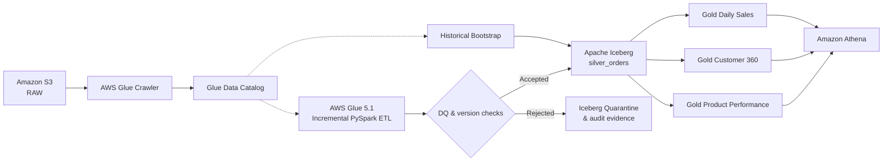
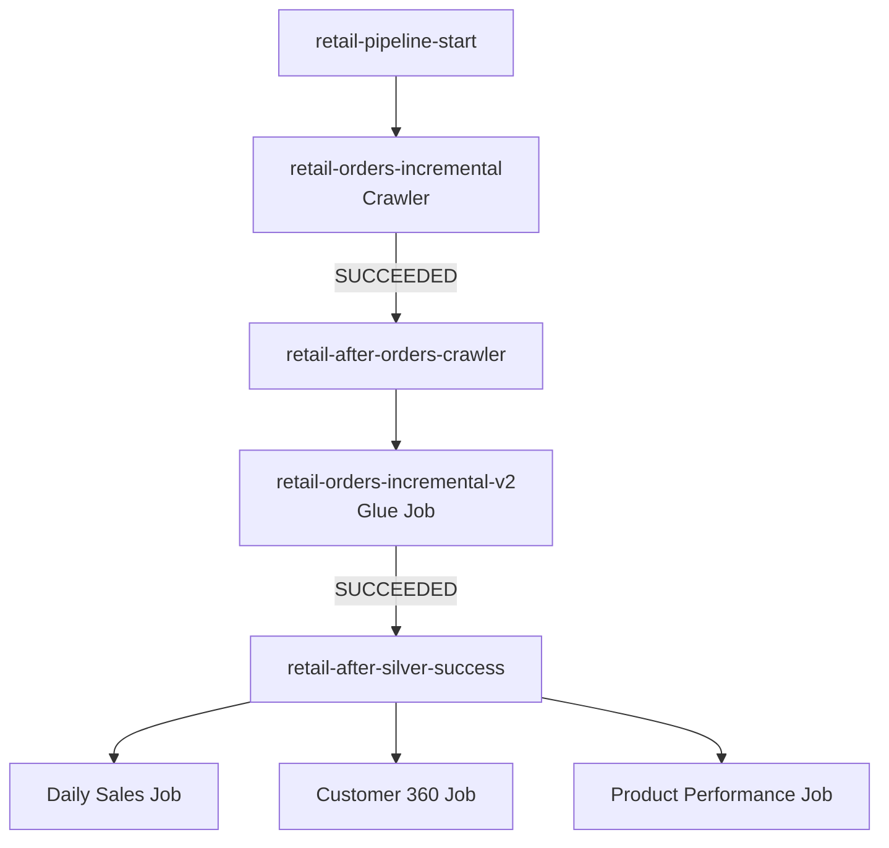
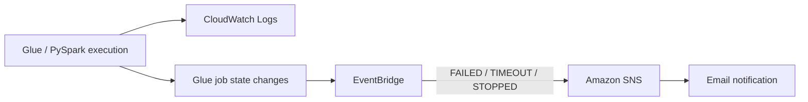

# AWS Retail Data Engineering V1

**A batch-oriented AWS lakehouse pipeline for retail order processing, incremental ingestion, data quality, analytics, and operational alerting.**

> **Project status:** V1 architecture frozen. This repository documents the established V1 design; proposed improvements belong in a separately labeled future version. Code, screenshots, and validation evidence should be added only after verification against the implementation.

## Architecture at a glance

The solution is organized into **three interacting planes**:

| Plane | Responsibility | AWS components |
|---|---|---|
| **Data** | Ingest, validate, curate, and query retail data | Amazon S3, AWS Glue Crawler & Data Catalog, AWS Glue 5.1 / PySpark, Apache Iceberg, Amazon Athena |
| **Control / orchestration** | Run the crawler, then incremental processing, then downstream Gold jobs after successful completion | AWS Glue triggers, crawler, and jobs |
| **Observability** | Collect execution logs and alert on selected failed job states | Amazon CloudWatch Logs, Amazon EventBridge, Amazon SNS, email |

### End-to-end data flow



*The Data Catalog supplies metadata; Glue reads source data from S3. Historical bootstrap is a separate one-time path from the bookmark-aware incremental job.*

### Control / orchestration flow



### Observability flow



*The logging path and state-change notification path are separate. The alert path is for `FAILED`, `TIMEOUT`, and `STOPPED` events; orchestration success dependencies are separate.*

## Data layers

| Layer | Key datasets / outputs |
|---|---|
| RAW | Customers, products, historical orders, incremental order batches |
| Silver | Apache Iceberg `silver_orders` |
| Quarantine | Rejected orders and supporting audit evidence |
| Gold | Daily Sales, Customer 360, Product Performance |
| Query | Amazon Athena reconciliation and business queries |

Incremental processing includes data-quality and reference checks, version logic, and hash comparison. Accepted records feed Silver; rejected records are kept in quarantine. Audit outputs are organized by pipeline or dataset.

## Implementation inventory

The frozen V1 S3 layout includes the following named scripts:

```text
scripts/
├── bootstrap/
│   └── orders_bootstrap.py
├── incremental/
│   └── orders_etl_v2_hardened_v4.py
└── gold/
    ├── gold_daily_sales_v1.py
    ├── gold_customer_360_v2.py
    └── gold_product_performance_v1.py
```

These are the **S3 script names**, not a claim that their source files have already been committed to GitHub.

## Repository guide

| Location | Contents |
|---|---|
| [`docs/architecture/S3_BUCKET_STRUCTURE.md`](docs/architecture/S3_BUCKET_STRUCTURE.md) | Frozen V1 S3 prefix and object structure |
| `docs/architecture/` | Publication-ready architecture images (to be added after review) |
| `scripts/` | Verified Glue/PySpark source code (to be added) |
| `sql/` | Verified Athena reconciliation and analytics queries (to be added) |
| `orchestration/` | Glue trigger configuration and execution evidence (to be added) |
| `monitoring/` | EventBridge/SNS configuration and sanitized log evidence (to be added) |
| `docs/design-decisions/` | Architecture decision records and supporting rationale (to be added) |
| `docs/validation/` | Test cases and verified results (to be added) |

## S3 storage layout

The documented bucket is `s3://rahini-aws-data-engineering-2026/`. Major prefixes are `raw/`, `scripts/`, `warehouse/customer_intelligence/`, `audit/`, and `athena-results/`. See the [full S3 bucket structure](docs/architecture/S3_BUCKET_STRUCTURE.md).

## Engineering principles

- Preserve the distinction between **historical bootstrap** and **incremental processing**.
- Apply data-quality and version checks before accepting incremental records into Silver.
- Keep rejected records and audit evidence separate from accepted Silver data.
- Launch the three Gold jobs only after successful completion of the incremental Silver job.
- Separate operational logging from state-change alerting.
- Record evidence and design decisions without retroactively altering the frozen V1 architecture.

## Publication and security notes

This repository is intended for technical documentation and a professional portfolio. Do **not** commit AWS access keys, secrets, customer-identifiable records, large S3 datasets, Iceberg data/metadata files, raw Athena results, or unredacted operational logs. Use small synthetic/sanitized samples and verified screenshots where appropriate.

---

**Scope:** Documentation of AWS Data Engineering Project V1. No infrastructure is deployed or changed by this README.
