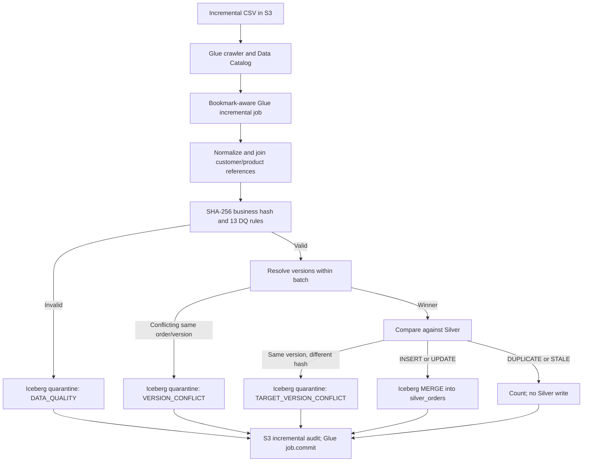

# Data Quality, Versioning & Quarantine — AWS Data Engineering 

> **Status:** This document describes what the uploaded scripts implement.

## 1. Scope and sources

- Historical bootstrap: [`orders_bootstrap.py`](../../scripts/bootstrap/orders_bootstrap.py)
- Incremental ETL: [`orders_etl_v2_hardened_v4.py`](../../scripts/incremental/orders_etl_v2_hardened_v4.py)
- Glue workflow: [`orchestration/README.md`](../../orchestration/README.md)

The historical bootstrap initializes an empty Iceberg `silver_orders` table. Incremental processing reads cataloged source orders with a stable Glue bookmark context (`orders_incremental_source`), validates them, resolves versions, MERGEs accepted changes into Silver, and records audit counts.

**Diagram note:** `superseded` valid rows are counted in audit, not written to quarantine by the incremental script. Quarantine MERGEs occur before Silver MERGE. The diagram is logical, not a transaction spanning all outputs.

## 2. The 13 incremental DQ rules

Implemented in `dq()` in `orders_etl_v2_hardened_v4.py`. A record may fail multiple rules; the script stores all failed IDs in `dq_rule_ids` and human-readable names in `dq_error_reasons`. Valid means the rule-ID array is empty.

| ID | Rule name | Reject when |
|---|---|---|
| DQ_001 | `order_id_not_null` | `order_id` is null |
| DQ_002 | `customer_id_not_null` | `customer_id` is null |
| DQ_003 | `product_id_not_null` | `product_id` is null |
| DQ_004 | `order_date_valid` | Parsed `order_date` is null |
| DQ_005 | `order_date_not_future` | `order_date` is after current processing date |
| DQ_006 | `quantity_positive` | Quantity is null or <= 0 |
| DQ_007 | `unit_price_non_negative` | Unit price is null or < 0 |
| DQ_008 | `discount_percentage_valid` | Discount is null, < 0, or > 100 |
| DQ_009 | `order_amount_positive` | Order amount is null or <= 0 |
| DQ_010 | `order_status_valid` | Status is null or not one of `Completed`, `Cancelled`, `Returned`, `Pending` |
| DQ_011 | `customer_reference_exists` | No matching customer ID in customer master |
| DQ_012 | `product_reference_exists` | No matching product ID in product master |
| DQ_013 | `source_updated_at_present` | Parsed `source_updated_at` is null |

### Mechanics and boundaries

- `normalize()` casts source fields before DQ, including dates, decimals, and timestamps.
- `refs()` joins distinct customer/product IDs via broadcast left joins and adds reference-presence flags.
- `hash_business()` computes SHA-256 over nine business columns: `customer_id`, `order_date`, `product_id`, `quantity`, `unit_price`, `discount_pct`, `order_amount`, `order_status`, `payment_method`. Nulls are represented by `<NULL>` and values joined with `||`.
- The hash intentionally excludes `order_id`, `source_updated_at`, and pipeline metadata; `order_id` is used separately as the business key.
- The script checks **null**, not blank string, for `order_id`, `customer_id`, and `product_id`. Blank IDs are not explicitly rejected by DQ_001–003, though unmatched references can fail DQ_011/012.
- The script does **not** explicitly check arithmetic consistency between `quantity`, `unit_price`, `discount_pct`, and `order_amount`.
- DQ_013 is incremental-only; bootstrap injects a fixed `bootstrap_version_timestamp` rather than reading source version timestamps.

## 3. Historical bootstrap DQ and duplicate handling

Bootstrap applies DQ_001–DQ_012 (not DQ_013), then groups valid rows by `order_id`:

| Situation | Bootstrap action |
|---|---|
| Invalid record | Append to Parquet quarantine, category `BOOTSTRAP_DATA_QUALITY` |
| Same `order_id`, different business hashes | Quarantine **all rows** for that key as `BOOTSTRAP_KEY_CONFLICT` |
| Same `order_id`, identical hash repeated | Keep one canonical row; quarantine extra copies as `BOOTSTRAP_DUPLICATE_COPY` |
| Valid unique/canonical row | Append to new Iceberg Silver table |

Canonical duplicate selection sorts by `record_hash` and `source_file`. Bootstrap refuses to write when the Silver target already contains rows. It checks `input = DQ rejected + duplicate copies + key conflicts + Silver inserts` and validates the resulting Silver row count. Bootstrap quarantine is **append-only partitioned Parquet** by `processing_date` and `quarantine_category`, not the incremental Iceberg quarantine table.

## 4. Incremental version-resolution scenarios

### 4.1 Resolve within the incoming batch

`resolve_batch()` groups valid rows by (`order_id`, `source_updated_at`) and counts distinct `record_hash` values:

| Incoming scenario | Implemented result |
|---|---|
| One version of an order | Candidate for batch winner |
| Same order and timestamp, different hashes | Every row in that conflicting order/timestamp group is categorized `VERSION_CONFLICT` and quarantined |
| Multiple non-conflicting timestamps for same order | Latest timestamp wins; older rows are `superseded` and counted, not quarantined |
| Exact repeated rows at same order/timestamp/hash | One candidate wins via `row_number()`; remaining copies are `superseded`, not quarantined |

**Subtlety:** A conflicting timestamp group is excluded, but a different non-conflicting timestamp for the same order can still become the winner. The script does not automatically reject the entire order key if one timestamp conflicts.

### 4.2 Compare the winner with existing Silver

`classify()` left-joins winners to Silver by `order_id`:

| Classification | Condition | Silver action |
|---|---|---|
| `INSERT` | Order key absent in Silver | Insert |
| `DUPLICATE` | Same timestamp and same hash | No change |
| `UPDATE` | Incoming timestamp newer | Candidate for MERGE update |
| `STALE` | Incoming timestamp older | No change |
| `CONFLICT` | Same timestamp but different hash | Quarantine as `TARGET_VERSION_CONFLICT` |

**Important MERGE guard:** The SQL update executes only when `incoming.source_updated_at > target.source_updated_at` **and** `incoming.record_hash <> target.record_hash`. Consequently, a newer timestamp with an unchanged hash is *classified and counted as* `UPDATE`, but does **not** update the Silver row/version. This is the existing V1 behavior and should not be represented as a successful physical update.

### 4.3 Worked examples

Assume Silver already contains order `O100` with timestamp `2026-10-01 10:00:00` and business hash `H1`.

| Incoming record | Classification | Result |
|---|---|---|
| New order `O200`, version 10:05, hash H2 | INSERT | Silver insert |
| `O100`, version 10:00, hash H1 | DUPLICATE | No Silver change |
| `O100`, version 10:10, hash H2 | UPDATE | Silver update |
| `O100`, version 09:55, hash H2 | STALE | No Silver change |
| `O100`, version 10:00, hash H2 | CONFLICT | Incremental Iceberg quarantine |
| `O100`, version 10:10, hash H1 | UPDATE (classified) | MERGE skips update because hash is unchanged |

These are **illustrative scenarios derived from the source conditions**, not claimed test results.

## 5. Incremental Iceberg quarantine

The incremental job creates the quarantine table if absent using `USING iceberg`, Iceberg format version 2, partitioned by `months(order_date)`. The location is built from `iceberg_warehouse`, `quarantine_database`, and `quarantine_orders_table`.

| Category | When used |
|---|---|
| `DATA_QUALITY` | One or more DQ rules failed |
| `VERSION_CONFLICT` | Same order/timestamp has multiple distinct business hashes within batch |
| `TARGET_VERSION_CONFLICT` | Incoming timestamp equals Silver timestamp but hash differs |

`qprep()` generates a SHA-256 `quarantine_key` using `order_id`, `source_updated_at`, `record_hash`, category, and sorted DQ rule IDs. It **excludes `source_file` and execution/run ID**, making identity stable across retries for the same rejected business version and reason.

`qmerge()` uses Iceberg `MERGE INTO`:

- **Matched key:** update `last_seen_at` and `last_pipeline_run_id`; preserve first-quarantine details.
- **New key:** insert rejected fields, category, rule IDs/reasons, first/last timestamps, and first/last run IDs.

The script's `source_file` for incremental records is the literal `incremental_orders_catalog`, not an actual S3 filename. It is therefore not sufficient for per-file traceability.

## 6. Audit, bookmarks and recovery behavior

### Normal incremental execution

1. Read the crawler-created orders table via Glue DynamicFrame using stable `transformation_ctx="orders_incremental_source"`.
2. If zero rows are returned, append an audit record with `status=NO_NEW_DATA`, call `job.commit()`, and exit.
3. Otherwise validate, quarantine invalid/version-conflict records, classify winners, and MERGE inserts/updates into Silver.
4. Append a Parquet audit record with input, DQ, conflict, superseded, insert, update, duplicate, stale, and target-conflict counts.
5. Call `job.commit()` to commit Glue job state/bookmark progression.

### Controlled failure and replay

The optional `--failure_injection AFTER_SILVER_MERGE` raises an intentional error **after the Silver Iceberg MERGE** and **before audit write and `job.commit()`**. This tests a partial-commit boundary: Silver can have committed while the Glue bookmark has not advanced. On retry, reprocessed records can be recognized as duplicates/stale/updates by the version/hash rules. Incremental quarantine's stable key supports MERGE-based replay behavior.

**Limits of the guarantee:** There is no single atomic transaction spanning quarantine, Silver, audit Parquet, and Glue bookmark state. 

### Audit field interpretation

| Field | Meaning |
|---|---|
| `input_record_count` | Rows in validated input before DQ split |
| `dq_rejected_count` | Invalid input rows |
| `batch_conflict_count` | Rows with same order/timestamp but conflicting hashes |
| `superseded_in_batch_count` | Non-winning valid candidates in batch |
| `insert_count` | Rows classified INSERT |
| `update_count` | Rows classified UPDATE|
| `duplicate_count` | Rows classified DUPLICATE |
| `stale_count` | Rows classified STALE |
| `target_conflict_count` | Rows classified CONFLICT against Silver |
| `status` | `SUCCEEDED` or `NO_NEW_DATA` for successfully committed execution paths |

The audit counts are stage-specific and should not be indiscriminately summed as disjoint categories. In particular, batch conflicts and superseded counts occur after the DQ split, and the five target classifications apply only to batch winners.

---

