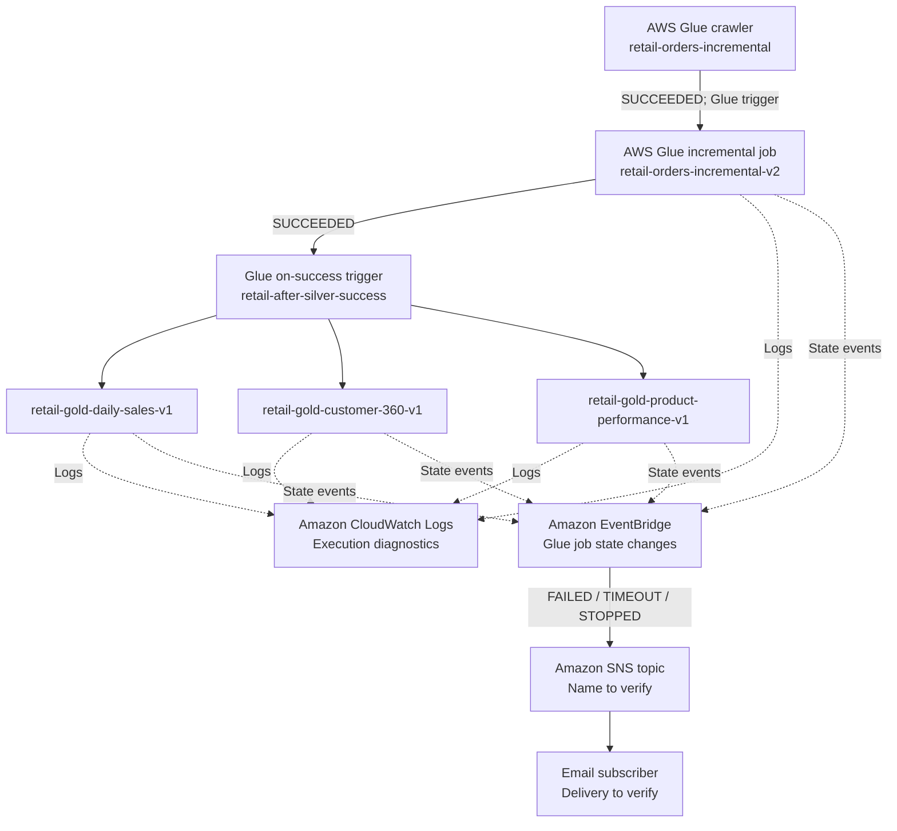

# Observability and Operational Monitoring — AWS Data Engineering 

## Purpose

Explain how the  Glue-based retail pipeline is observed, how failures are surfaced, and how an operator investigates them. successful Glue job/crawler completion advances dependent tasks through Glue triggers; failure events drive notifications through EventBridge and SNS.

## Three distinct responsibilities

| Responsibility | service | Behavior |
|---|---|---|
| Pipeline control | AWS Glue workflow and triggers | On-success dependencies: crawler → incremental Silver job → three Gold jobs |
| Execution diagnosis | Amazon CloudWatch Logs | Glue/PySpark execution and troubleshooting logs |
| Failure notification | Amazon EventBridge → Amazon SNS → email | Job state changes matching `FAILED`, `TIMEOUT`, or `STOPPED` |

## Logical architecture




## Confirmed V1 orchestration context

1. `retail-pipeline-start` — on-demand Glue trigger starts `retail-orders-incremental` crawler.
2. `retail-after-orders-crawler` — conditional trigger starts `retail-orders-incremental-v2` after crawler success.
3. `retail-after-silver-success` — conditional trigger starts the three Gold jobs after incremental job success.
4. Historical bootstrap is separate from the recurring incremental chain.

## CloudWatch Logs: operational troubleshooting

Glue/PySpark job execution writes logs for investigation. For an incident:

1. Open **AWS Glue → ETL jobs → [job] → Runs** and select the failed run.
2. Record the Glue **job name**, **run ID**, start/end times (with timezone), and final state.
3. Open the run's CloudWatch log links. Locate the first meaningful exception, not only the last stack trace line.
4. Identify whether the failure occurred during source read, DQ/quarantine, Silver MERGE, Gold overwrite, reconciliation, audit write, or job commit.
5. Check the previous successful run and whether downstream Gold jobs were triggered.
6. Document the cause, remediation, and re-run evidence. 

## EventBridge failure notifications

The frozen V1 design routes Glue job state-change events with failure states through EventBridge to SNS. The intended matching states are:

- `FAILED`
- `TIMEOUT`
- `STOPPED`

**Illustrative event-pattern shape (NOT an exported V1 rule):**

```json
{
  "source": ["aws.glue"],
  "detail-type": ["Glue Job State Change"],
  "detail": {
    "state": ["FAILED", "TIMEOUT", "STOPPED"]
  }
}
```

## SNS email notification

The conceptual delivery path is **EventBridge rule → SNS topic → confirmed email subscription**. Verify the SNS topic ARN , topic policy allowing EventBridge publishing, subscription status, and a sample of a delivered notification.

SNS notification delivery is separate from Glue workflow success dependencies. A notification does not by itself retry a failed job or roll back Iceberg changes.

## Failure and replay behavior from source code

The incremental script `scripts/incremental/orders_etl_v2_hardened_v4.py` includes an optional `--failure_injection AFTER_SILVER_MERGE` test path. It deliberately raises an exception **after the Silver Iceberg MERGE but before `job.commit()`**. This is a resilience test boundary, not an automatically enabled production setting.

Implications:

- Silver data may already be committed when a Glue run fails.
- The Glue bookmark may not have advanced because `job.commit()` was not reached.
- Replayed input is evaluated against existing Silver records using version timestamps and record hashes.
- Quarantine is written using an Iceberg `MERGE` keyed by a deterministic `quarantine_key`.
- Audit output, Silver MERGE, quarantine MERGE, and bookmark commit are **not a single atomic transaction**.

## Operator response matrix

| Observation | First check | Follow-up |
|---|---|---|
| Crawler failed | Crawler runs and logs | Check S3 source, permissions, schema discovery; verify conditional job did not start |
| Incremental Glue job failed | Job run details and CloudWatch logs | Check source schema, DQ/quarantine, Iceberg MERGE, bookmark/replay boundary |
| Gold job failed | Gold job logs and reconciliation exception | Determine which Gold table was affected; verify whether other Gold jobs succeeded |
| No new source data | Incremental audit `NO_NEW_DATA` and bookmark state | Confirm zero-row bookmarked read is expected; not automatically a failure |
| SNS email not received | EventBridge matched event, target, SNS subscription | Verify rule enabled, matching pattern, publish permissions, confirmed email subscription |


