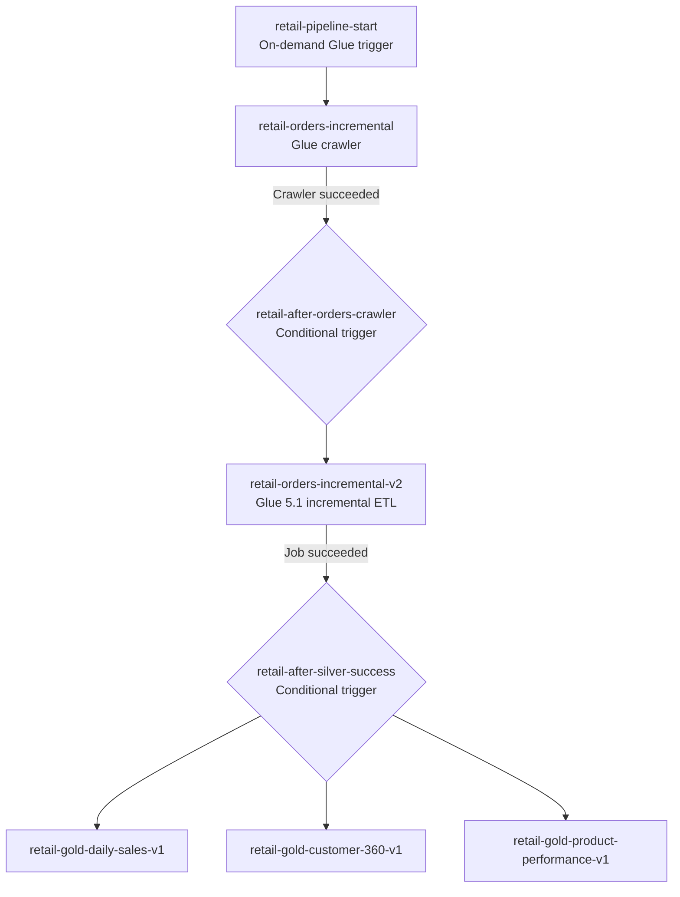

# AWS Glue Orchestration — Verified Configuration

## Workflow

**AWS Glue workflow:** `retail-data-platform-v1`

**Historical bootstrap:** `orders_bootstrap.py` is a separate one-time load, not a step in this incremental workflow.

## Crawler and Data Catalog

| Setting | Value | 
|---|---|---|
| Crawler | `retail-orders-incremental` | 
| S3 source | `s3://rahini-aws-data-engineering-2026/raw/orders_incremental/` |
| Catalog database | `customer_intelligence` | 
| Output table | `incremental_orders_incremental` |
| Schema update behavior | Update table definition in Data Catalog | 
| Schema delete behavior | Mark table as deprecated |
| Recrawl policy | **Crawl all folders** | 

A crawler discovers/updates catalog **metadata**; the source CSV data remains in S3.

## ETL job settings

| Setting | Incremental Silver | Gold: all three jobs |
|---|---|---|
| Glue version | 5.1 | 5.1|
| Worker type | G.1X | G.1X|
| Number of workers | 2 | 2|
| Execution class | Standard | Standard |
| Timeout | 480 minutes|
| Job bookmarks | Enabled  |
| Retry count | 0  |
| CloudWatch log group | `/aws-glue/jobs` | `/aws-glue/jobs`  |

**Job names:**
- Incremental: `retail-orders-incremental-v2`
- Gold: `retail-gold-daily-sales-v1`, `retail-gold-customer-360-v1`, `retail-gold-product-performance-v1`

The incremental script reads its source through a Glue Data Catalog DynamicFrame with a stable `transformation_ctx`, and calls `job.commit()` after successful processing. Job bookmarks are owner-reported as enabled; bookmark configuration and replay behavior should be validated from job settings/run evidence.

## Execution evidence (UTC)

| Evidence | Date | Start | End | Status | Notes |
|---|---|---|---|---|---|
| Workflow `retail-data-platform-v1` | 2026-10-05 | 18:11:56 | 18:17:41 | Completed | 5m 45s; workflow run screenshot |
| Crawler run | 2026-10-05 | 18:12:31 | 18:13:06 | Completed | Updated `incremental_orders_incremental`; no new tables or partitions shown |
| Incremental job run | 2026-10-04 | 17:47:16 | 17:48:19 | Succeeded | 56s execution + 7s startup shown; trigger field `-` |
| Gold Customer 360 run | 2026-10-05 | 18:15:56 | 18:17:33 | Succeeded | Trigger `retail-after-silver-success` |
| Gold Product Performance run | 2026-10-05 | 18:15:56 | 18:17:41 | Succeeded | Trigger `retail-after-silver-success` |
| Gold Daily Sales run | 2026-10-06 | 09:08:37 | 09:10:12 | Succeeded | Trigger field `-` |

A `-` in the **Trigger name** field of a particular job run is recorded as shown; it is not evidence that no trigger is configured for that job.

## Control plane versus observability

- **Control plane:** Crawler success gates incremental ETL; incremental job success gates three Gold branches.
- **Execution logs:** Glue jobs write to CloudWatch Logs (`/aws-glue/jobs` ).
- **Failure alert path :** Glue job state-change events → EventBridge filter for `FAILED`, `TIMEOUT`, `STOPPED` → SNS → email. 
- Success-triggered dependencies and failure notifications are separate paths.

