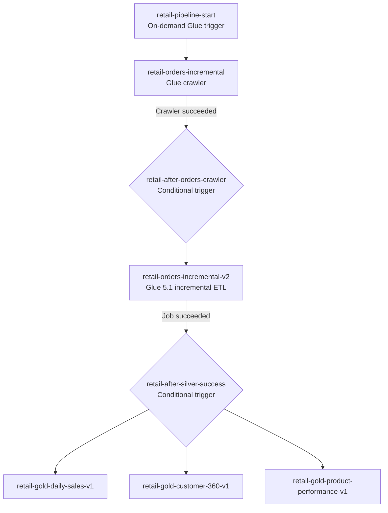

# AWS Glue Orchestration — V1 Verified Configuration

> **Frozen V1:** This document records the existing AWS Data Engineering Project V1 implementation. It does not propose a redesign. **Evidence levels:** *Configured/reported* = settings supplied by project owner; *Screenshot-verified* = visible in AWS console screenshots; *Pending* = not yet demonstrated.

## Workflow

**AWS Glue workflow:** `retail-data-platform-v1` (**screenshot-verified**).

The diagram combines the frozen V1 workflow with owner-reported trigger types and exact Gold job names. A screenshot shows the first four nodes succeeded in a workflow graph; the full downstream graph and exact trigger predicates remain to be verified from configuration screenshots. The three Gold branches are not assumed to run in any particular order.

**Historical bootstrap:** `orders_bootstrap.py` is a separate one-time load, not a step in this incremental workflow.

## Crawler and Data Catalog

| Setting | Value | Evidence |
|---|---|---|
| Crawler | `retail-orders-incremental` | Owner-reported; workflow graph shows truncated label |
| S3 source | `s3://rahini-aws-data-engineering-2026/raw/orders_incremental/` | Owner-reported |
| Catalog database | `customer_intelligence` | Owner-reported |
| Output table | `incremental_orders_incremental` | Screenshot-verified as updated by crawler |
| Schema update behavior | Update table definition in Data Catalog (`UPDATE_IN_DATABASE` equivalent) | Owner-reported console wording |
| Schema delete behavior | Mark table as deprecated (`DEPRECATE_IN_DATABASE` equivalent) | Owner-reported console wording |
| Recrawl policy | **Crawl all folders** | Owner-confirmed selected console option |

A crawler discovers/updates catalog **metadata**; the source CSV data remains in S3.

## ETL job settings

| Setting | Incremental Silver | Gold: all three jobs |
|---|---|---|
| Glue version | 5.1 | 5.1 |
| Worker type | G.1X | G.1X |
| Number of workers | 2 | 2 |
| Execution class | Standard (screenshot) | Standard (screenshots) |
| Timeout | 480 minutes (screenshot) | 480 minutes (screenshots) |
| Job bookmarks | Enabled (owner-reported) | Not confirmed; not required to infer |
| Retry count | 0 (owner-reported) | Not confirmed |
| CloudWatch log group | `/aws-glue/jobs` (screenshot) | `/aws-glue/jobs` (screenshots) |

**Job names:**
- Incremental: `retail-orders-incremental-v2`
- Gold: `retail-gold-daily-sales-v1`, `retail-gold-customer-360-v1`, `retail-gold-product-performance-v1`

**Script-to-job distinction:** The Glue job `retail-gold-customer-360-v1` is not named after the uploaded script `gold_customer_360_v2.py`; confirm its configured script path before claiming which version ran. The other uploaded scripts are `orders_etl_v2_hardened_v4.py`, `gold_daily_sales_v1.py`, and `gold_product_performance_v1.py`; actual deployed script locations remain pending verification.

### Runtime arguments

The uploaded incremental script requires `JOB_NAME`, `environment`, `database`, `orders_table`, `customers_table`, `products_table`, `iceberg_catalog`, `iceberg_warehouse`, `silver_database`, `silver_orders_table`, `quarantine_database`, `quarantine_orders_table`, and `incremental_audit_path`. It also accepts optional `failure_injection` for controlled resilience tests. **These are code-level argument names, not verified deployed values.** Glue job default arguments and per-run overrides have not been supplied.

The incremental script reads its source through a Glue Data Catalog DynamicFrame with a stable `transformation_ctx`, and calls `job.commit()` after successful processing. Job bookmarks are owner-reported as enabled; bookmark configuration and replay behavior should be validated from job settings/run evidence.

## Execution evidence (UTC)

| Evidence | Date | Start | End | Status | Notes |
|---|---|---|---|---|---|
| Workflow `retail-data-platform-v1` | 2026-10-05 | 18:11:56 | 18:17:41 | Completed | 5m 45s; workflow run screenshot |
| Crawler run | 2026-10-05 | 18:12:31 | 18:13:06 | Completed | Updated `incremental_orders_incremental`; no new tables or partitions shown |
| Incremental job run | 2026-10-04 | 17:47:16 | 17:48:19 | Succeeded | 56s execution + 7s startup shown; trigger field `-` |
| Gold Customer 360 run | 2026-10-05 | 18:15:56 | 18:17:33 | Succeeded | Trigger `retail-after-silver-success` |
| Gold Product Performance run | 2026-10-05 | 18:15:56 | 18:17:41 | Succeeded | Trigger `retail-after-silver-success` |
| Gold Daily Sales run | 2026-10-06 | 09:08:37 | 09:10:12 | Succeeded | Trigger field `-` |

**Evidence limitation:** The October 4 incremental run and October 6 Daily Sales run are **not** the October 5 workflow execution. Do not present them as one complete, correlated run. The October 5 crawler, workflow, Customer 360 and Product Performance timestamps are consistent with the workflow window, but exact per-run correlation for all nodes is still pending. The October 5 screenshot shows a partial graph with succeeded start trigger, crawler, conditional trigger, and incremental job; it does not show the full Gold branch.

A `-` in the **Trigger name** field of a particular job run is recorded as shown; it is not evidence that no trigger is configured for that job.

## Control plane versus observability

- **Control plane:** Crawler success gates incremental ETL; incremental job success gates three Gold branches.
- **Execution logs:** Glue jobs write to CloudWatch Logs (`/aws-glue/jobs` visible in screenshots).
- **Failure alert path (frozen architecture):** Glue job state-change events → EventBridge filter for `FAILED`, `TIMEOUT`, `STOPPED` → SNS → email. The specific EventBridge rule and SNS subscription configuration are **not yet screenshot-verified**.
- **Do not confuse:** Success-triggered dependencies and failure notifications are separate paths.

## Outstanding configuration evidence

- [x] Workflow name and completed workflow run screenshot
- [x] Crawler run and updated Data Catalog table
- [x] Exact Gold Glue job names and successful example runs
- [x] Glue 5.1, G.1X, two workers, 480-minute timeout from job screenshots
- [x] Owner-reported three trigger types, crawler S3 source/database, bookmark and retry settings
- [x] Confirm selected **crawler recrawl policy** — Crawl all folders (owner-confirmed)
- [ ] Confirm each conditional trigger's exact predicates/actions in console
- [ ] Capture full October 5 workflow graph and same-run Daily Sales execution evidence
- [ ] Confirm deployed script S3 paths, particularly Customer 360 script version
- [ ] Capture sanitized job default arguments / overrides, including Iceberg and bookmark settings
- [ ] Confirm EventBridge/SNS rule/subscription evidence in monitoring documentation

## Related documentation

- [Project overview](../README.md)
- [S3 bucket structure](../docs/architecture/S3_BUCKET_STRUCTURE.md)
- [Scripts](../scripts/README.md)
