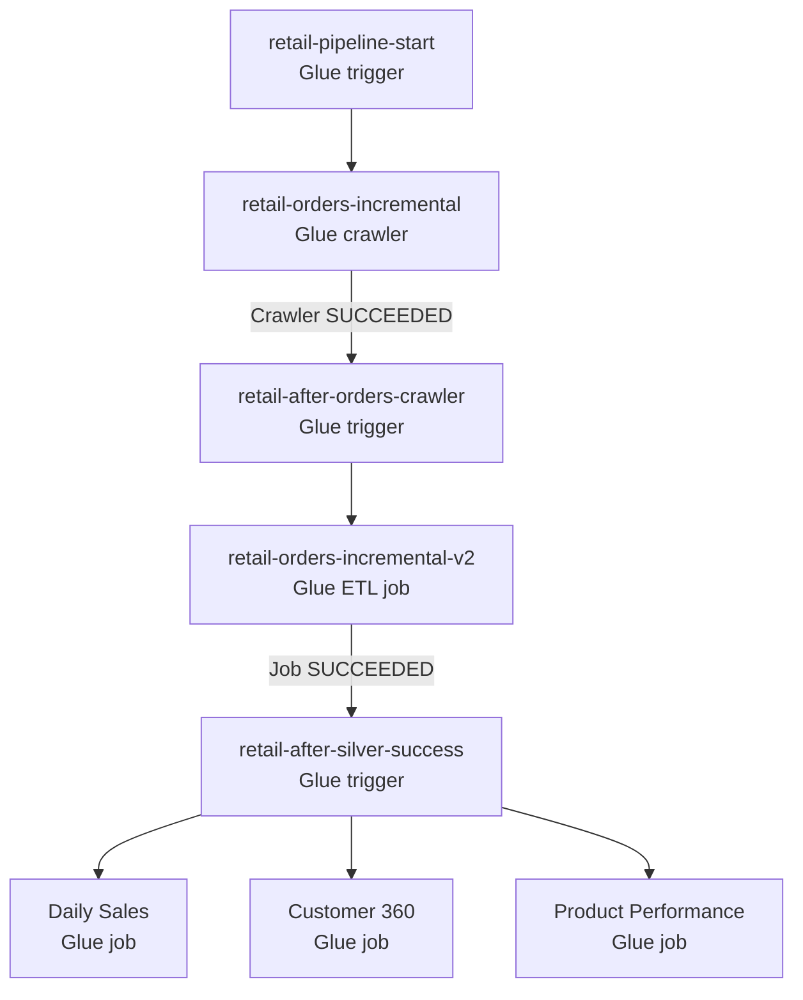

# V1 Glue Orchestration — Frozen Implementation Reference

> **Scope:** This document records the orchestration sequence supplied for AWS Data Engineering Project V1. It does not propose changes to V1. Trigger configuration details not present in the frozen evidence are deliberately not asserted.

## Workflow

## Execution sequence

1. `retail-pipeline-start` initiates the `retail-orders-incremental` crawler.
2. Once the crawler **succeeds**, `retail-after-orders-crawler` activates the incremental ETL job.
3. `retail-orders-incremental-v2` performs the bookmark-aware incremental Silver processing described in the Data Plane.
4. Once the incremental job **succeeds**, `retail-after-silver-success` starts the three downstream Gold jobs as separate branches.
5. The Gold jobs produce Daily Sales, Customer 360, and Product Performance analytics datasets.

## Plane interactions

- **Control → Data:** The crawler discovers metadata; the incremental ETL updates Iceberg Silver; the three Gold jobs build analytics outputs.
- **Data → Observability:** Glue execution emits logs to CloudWatch Logs and job state-change events to EventBridge.
- **Alerting:** EventBridge filters `FAILED`, `TIMEOUT`, and `STOPPED` events and routes matching events through SNS to email subscribers. Success events are not part of this alert path.

## Operational boundaries

- A **success dependency** gates the incremental ETL after the crawler and gates Gold processing after Silver ETL.
- The three Gold jobs branch from the same downstream trigger; this diagram does not assert a completion order among them.
- Trigger type (scheduled/on-demand/conditional), retry policy, concurrency, timeout values, IAM policies, and specific Gold job resource names require configuration evidence before publication as implementation facts.
- Historical bootstrap is a separate one-time Data Plane operation and is not inserted into this recurring incremental orchestration chain.

## Verification checklist

- [ ] Capture Glue console configuration for the three named triggers.
- [ ] Confirm crawler and incremental job resource names and success predicates.
- [ ] Confirm each Gold job's exact AWS Glue resource name.
- [ ] Attach sanitized evidence of a successful end-to-end run.
- [ ] Confirm EventBridge rule patterns and SNS subscription status in the monitoring documentation.

## Related documentation

- [Project overview](../README.md)
- [S3 bucket structure](../docs/architecture/S3_BUCKET_STRUCTURE.md)

**Evidence status:** Workflow sequence and named control resources are based on the supplied frozen V1 architecture. Configuration-level assertions remain pending verification.
